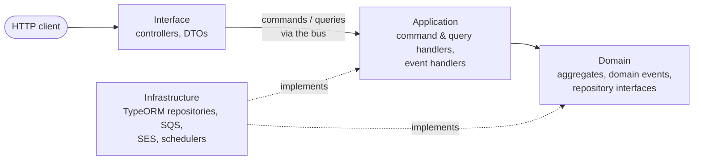
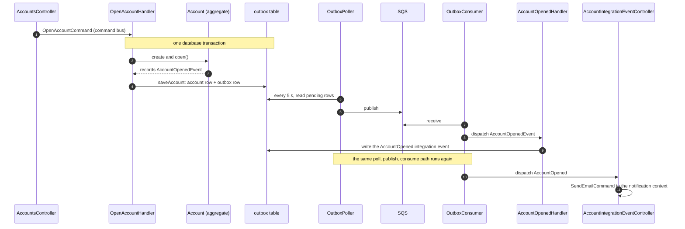

# Nest CQRS REST API example


A worked example of layered DDD + CQRS in [NestJS](https://nestjs.com): domain / application / interface / infrastructure
layers, aggregates and domain events, command/query separation, and a transactional outbox that publishes events through
SQS — all in one runnable REST API (TypeScript, MySQL, LocalStack).

This is the repo's most-starred project (870+ stars). It is kept as a stable reference rather than under active feature
development; the layering and event patterns below are the lasting part.

**Related**
- [backend-service-playbook](https://github.com/kyhsa93/backend-service-playbook) — this repo's conventions generalized: the same architecture implemented
  identically in 5 languages, with an automated compliance harness. To check your own NestJS project against those rules:
  `npx skills add kyhsa93/backend-service-playbook --skill nestjs-architecture-harness`
- [k8s-playbook](https://github.com/kyhsa93/k8s-playbook) — the deployment side: a Kubernetes deployment anti-pattern catalog with an automated detection harness.

## At a glance

| | |
|---|---|
| **Stack** | NestJS, TypeScript, TypeORM, MySQL 8.4, `@nestjs/cqrs`, AWS SQS / SNS / SES / Secrets Manager (LocalStack locally) |
| **Domains** | `account` (open, deposit, withdraw, remit, change password, close) and `notification` (email on account events) |
| **Patterns** | Aggregates that record domain events, repository interfaces in the domain layer, factories, CQRS command/query buses, transactional outbox |
| **Checks** | Unit tests with Jest, lint, and an architecture-compliance gate in CI (score ≥ 90, using the [backend-service-playbook](https://github.com/kyhsa93/backend-service-playbook) harness) |

### Dependency rule

Every dependency points inward, toward the domain layer. Infrastructure implements the interfaces that the domain and
application layers define.



### What happens when an account is opened

`POST /accounts` runs one command. The aggregate records a domain event, the repository writes it to the outbox in the
same transaction, and everything after that is event-driven. Two hops go through the outbox and SQS: the domain event,
then the integration event that the domain event handler produces.



Because the account row and its outbox row are committed together, an event is never published for a change that was
rolled back, and a committed change is never left without its event.

## Introduction

Domain-driven design and CQRS can be used to design the individual services of a microservice architecture. This
repository shows one such service built with NestJS.

The design has four layers. Each layer depends only on the layers inside it, so we start with the most important one,
the domain layer.

### Domain layer

The core layer of domain-driven design and the one that depends on nothing else.

- The model is made of aggregates and entities (and value objects where needed), and the core business logic lives inside it.
- Domain events are defined here and raised when domain logic runs. Event handlers in the application layer receive them.
- The repository interface is defined here and its implementation is in the infrastructure layer (separated interface
  pattern). A repository manages a collection of domain objects.
- Domain objects are created through factories.

### Application layer

Depends on the domain layer and runs its logic.

- **Commands** change state. A command handler creates a domain object or loads it from the repository, runs the domain
  logic and saves it through the repository. Access to the domain happens only through commands, so every event is
  triggered by a command.
- **Queries** only read. A query handler runs a query defined as an interface and never touches the domain model.
- **Domain event handlers** react to the events raised by commands.
- **Integration events** are for services in other contexts and are published through the integration event publisher.
  Adapters for external communication are defined here as interfaces, so a service can be integrated with others
  synchronously or asynchronously.

### Interface layer

Depends on the application layer. It receives HTTP (or message) requests, validates them, builds the commands and queries
and executes them through the bus, and returns the response.

### Infrastructure layer

Implements the technical details of the other layers: repositories, publishers and adapters, database access,
messaging, caching and external communication. Keeping all of them here isolates technical changes so they do not spread
to the rest of the code.

See the picture below. [[image source]](http://seedstack.org/docs/business/layers/)


### Project layout

```
src/
  account/        domain · application (command, query, event) · interface · infrastructure
  notification/   the same four layers; reacts to account integration events
  outbox/         OutboxWriter, OutboxPoller, OutboxConsumer, EventHandlerRegistry
  config.ts       environment configuration, validated on startup
libs/             shared modules: database, auth, message, secret, error, logging, discovery
test/             unit tests for command handlers and the outbox (domain tests sit next to the code)
```

## API

Swagger UI is served at `/api` (for example http://localhost:5000/api).

| Method | Path | |
|---|---|---|
| `POST` | `/accounts` | Open an account |
| `GET` | `/accounts`, `/accounts/:accountId` | List / find accounts |
| `POST` | `/accounts/:accountId/deposit`, `/withdraw`, `/remit` | Deposit, withdraw, remit |
| `PATCH` | `/accounts/:accountId/password` | Change the password |
| `DELETE` | `/accounts/:accountId` | Close the account |
| `GET` | `/notifications`, `/accounts/:accountId/notifications` | Find notifications |
| `GET` | `/health` | Health check |

## Getting started

This is a REST API built with Node.js, NestJS and MySQL in TypeScript.

AWS services (SQS, SNS, SES, Secrets Manager) are used for messaging, email and the database credentials. In local
development they are emulated by [LocalStack](https://www.localstack.cloud/).

Domain events are stored in an outbox table in the same transaction as the aggregate. `OutboxPoller` publishes pending
rows to SQS, and `OutboxConsumer` receives them from SQS and dispatches them through `EventHandlerRegistry`
(see `src/outbox`).

So you need Node.js, MySQL, and LocalStack (or real AWS). Docker is the easiest way to get the last two.

### Prerequisites

- Node.js 24 (see `.nvmrc`): https://nodejs.org/en/download/
- Docker Desktop, which includes Docker Compose: https://docs.docker.com/get-started/get-docker/

### Run it locally

```bash
git clone https://github.com/kyhsa93/nestjs-rest-cqrs-example.git
cd nestjs-rest-cqrs-example
npm install

docker compose up -d database localstack   # MySQL 8.4 and LocalStack
```

LocalStack runs `.aws/localstack.sh` on startup. It creates the database secret `nest/database`, the SQS queue `example`
for integration events and the SQS queue `domain-events` for outbox domain events (each with a dead letter queue), the
SNS topics and the verified SES sender `no-reply@example.com`.

MySQL is on `localhost:3306` (user `root`, password `test`).

The API reads its configuration from environment variables (there is no `.env` file). Export them in your terminal:

```bash
export AWS_REGION=ap-northeast-2
export AWS_ENDPOINT=http://localhost:4566
export AWS_ACCESS_KEY_ID=test
export AWS_SECRET_ACCESS_KEY=test
export AWS_SQS_QUEUE_URL=http://localhost:4566/000000000000/example
export SQS_DOMAIN_EVENT_QUEUE_URL=http://localhost:4566/000000000000/domain-events
export DATABASE_LOGGING=true
export DATABASE_HOST=localhost
export DATABASE_PORT=3306
export DATABASE_NAME=nest
export DATABASE_SECRET_ID=nest/database
export DATABASE_SYNC=true
export EMAIL=no-reply@example.com
export PORT=5000
```

Then start the API in watch mode. It restarts when you save a change.

```bash
npm run start:dev
```

Open http://localhost:5000/api for the Swagger UI. When you are done: `docker compose down`.

## Other ways to run it

### Docker

```bash
docker build -t nest-sample .
docker run -d -p 5000:5000 -e AWS_REGION=ap-northeast-2 -e ... nest-sample
```

The container needs the same environment variables as above (see [Configuration](#configuration)), and a reachable
MySQL and AWS (or LocalStack). The API is then on http://localhost:5000.

### Docker Compose

The compose file contains the API, an nginx proxy, MySQL 8.4 and LocalStack. The API container is built from
`Dockerfile.dev` and runs `npm run start:debug` with `src` and `libs` mounted, so code changes are reloaded. The debugger
port is 9229.

```bash
docker compose up -d           # build images, create and start the containers
docker compose up -d --build   # rebuild after package.json or Dockerfile.dev changes
docker compose down            # stop and remove them
```

The API is on http://localhost:5000, or through the nginx proxy on http://localhost. MySQL is on `localhost:3306`
(user `root`, password `test`).

### Kubernetes

`manifest.yaml` creates the API and MySQL only. It does not include LocalStack and targets real AWS, so replace the
`<ACCOUNT_ID>` and queue name placeholders in `AWS_SQS_QUEUE_URL` and `SQS_DOMAIN_EVENT_QUEUE_URL` with your own SQS
queues before applying. The `nest/database` secret and the SES sender in `EMAIL` must also exist in your AWS account. To
use a LocalStack that runs in the cluster instead, add `AWS_ENDPOINT` pointing at it.

Use [minikube](https://minikube.sigs.k8s.io/docs/start/) or any other cluster (Docker Desktop can enable a local one).

```bash
kubectl apply -f manifest.yaml    # create the resources
kubectl delete -f manifest.yaml   # delete them

kubectl get all                                              # everything in the default namespace
kubectl logs deployment.apps/nest --all-containers=true -f   # follow the logs
```

When the Deployments, Services and Pods are ready, the API is on http://localhost and the Swagger UI on
http://localhost/api.

## Configuration

All configuration is in [src/config.ts](src/config.ts). It is read from environment variables and validated on startup;
if a required value is missing, the API exits.

| Name | Required | Description |
|---|---|---|
| `AWS_REGION` | yes | AWS region |
| `AWS_ENDPOINT` | no | AWS endpoint override, e.g. `http://localhost:4566` for LocalStack |
| `AWS_SQS_QUEUE_URL` | yes | SQS queue for integration messages (`libs/message`). `OutboxPoller` falls back to it when `SQS_DOMAIN_EVENT_QUEUE_URL` is not set |
| `SQS_DOMAIN_EVENT_QUEUE_URL` | no | SQS queue for domain events. `OutboxPoller` publishes here instead of `AWS_SQS_QUEUE_URL` when set, and `OutboxConsumer` only consumes when it is set |
| `DATABASE_HOST`, `DATABASE_PORT`, `DATABASE_NAME` | yes | MySQL connection |
| `DATABASE_SECRET_ID` | yes | Secrets Manager secret holding `{"username","password"}` for MySQL |
| `DATABASE_LOGGING`, `DATABASE_SYNC` | yes | `true` or `false` |
| `EMAIL` | yes | SES sender address |
| `PORT` | yes | HTTP port |

## Scripts

```bash
npm install         # install packages
npm test            # unit tests
npm run lint        # eslint
npm run build       # compile TypeScript
npm run start:dev   # run in watch mode
npm run start:prod  # run the compiled code in dist
```

## Links

- GitHub: https://github.com/kyhsa93/nestjs-rest-cqrs-example
- Docker Hub: https://hub.docker.com/r/kyhsa93/nestjs-rest-cqrs-example

## License

[MIT](LICENSE)
